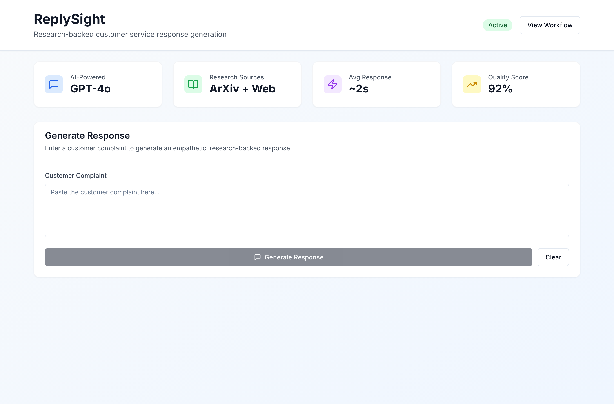
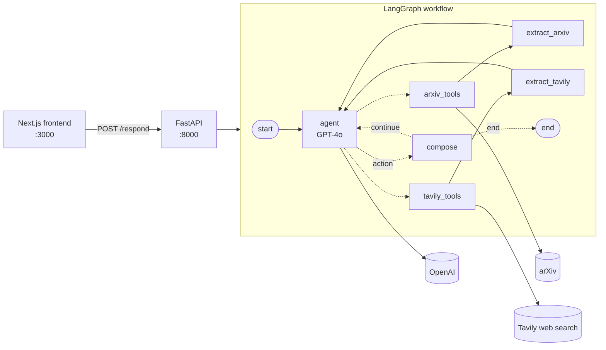
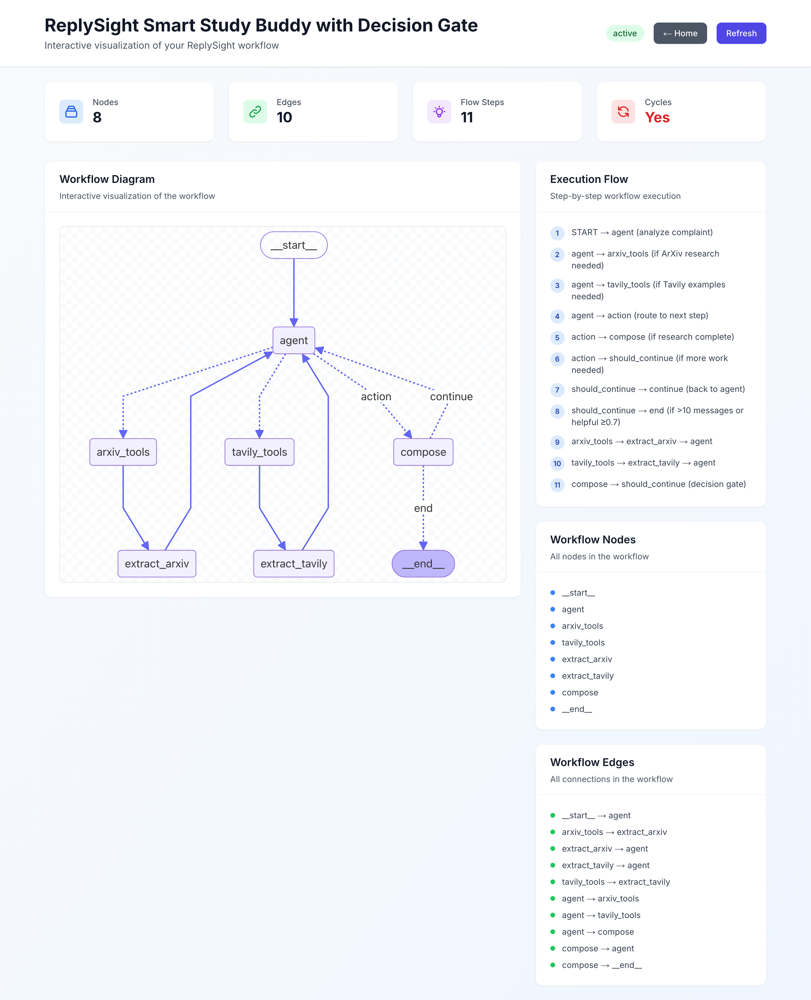
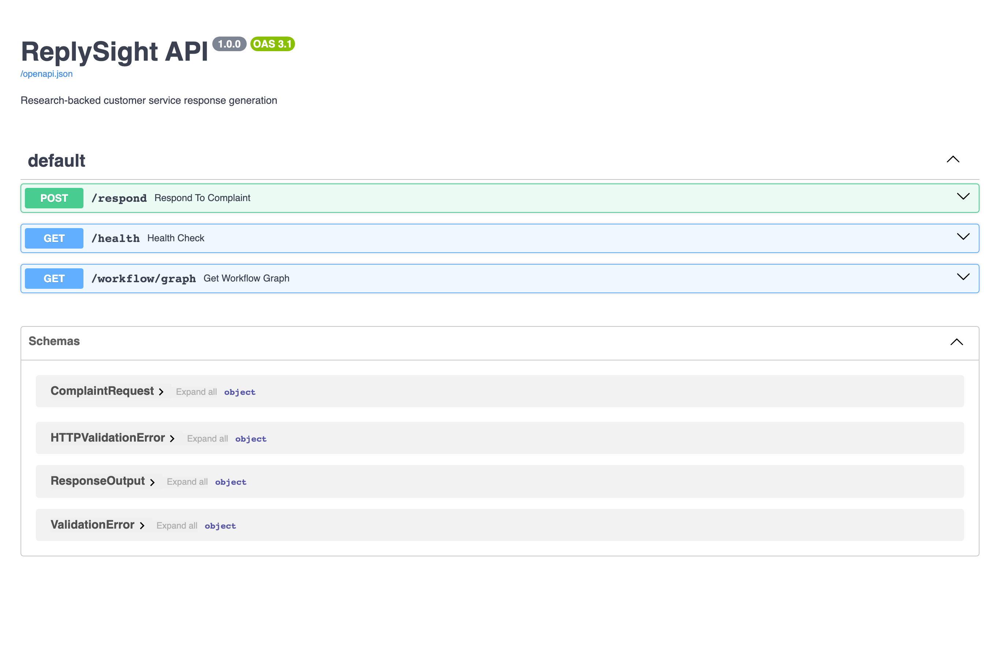
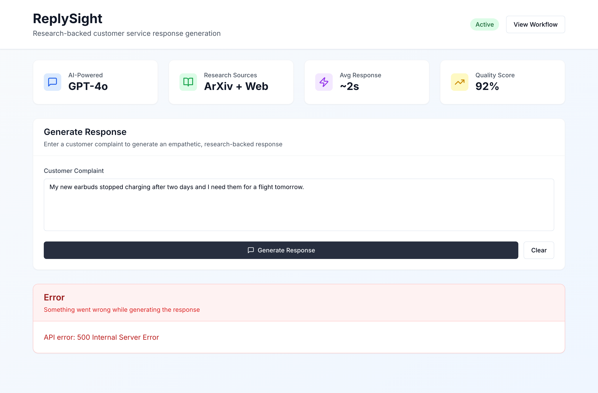

<p align="center"></p>

# ReplySight

<p align="center"></p>

**Research-backed customer-service replies from an agentic LangGraph workflow.**

A support agent pastes a customer complaint. A GPT-4o agent searches arXiv for service-recovery research and the web (Tavily) for real-world examples, then drafts an empathetic reply with citations.



---

## Business case

Support agents lose time finding the right words for difficult complaints, and research on 5,179 support agents found AI assistance raised their productivity by 14% on average. ReplySight drafts an empathetic reply backed by service-recovery research and real examples, for the agent to edit and send. It works best as a drafting aid for newer agents. [docs/BUSINESS_CASE.md](docs/BUSINESS_CASE.md) covers the sourced evidence, use cases, an illustrative ROI model and the limits.

## 1. The problem

Support reps lose minutes per ticket hunting for good phrasing and best practice. ReplySight puts that research behind a single button.

## 2. How it works

<p align="center"></p>



The diagram follows the live `/workflow/graph` output (8 nodes, 10 edges); see [`docs/screenshots/api-samples.json`](docs/screenshots/api-samples.json).

## 3. Run it locally

```bash
cp .env.example .env        # add OPENAI_API_KEY and TAVILY_API_KEY to get real replies
docker compose up -d --build --wait
open http://localhost:3000  # UI
open http://localhost:8000/docs
docker compose down
```

Without keys, the stack still starts and reports healthy. `/health` shows `openai: false, tavily: false`, and generating a reply returns an error (see below).

## 4. What you get

| Screen | Screenshot |
| --- | --- |
| Chat: paste a complaint |  |
| Workflow view: the LangGraph diagram, rendered live from the API |  |
| API docs (FastAPI) |  |

### Model-dependent screen: not run

These screenshots were taken **without an OpenAI or Tavily key**, so no reply was generated. This is what the app really shows when you submit a complaint with no key (the API returns 500 because OpenAI rejects the request):



With valid keys in `.env`, this panel shows the drafted reply and its citations. That output has not been captured here.

## 5. Tests and CI

```bash
uv run --no-project --python 3.12 --with-requirements requirements.txt \
  --with-requirements requirements-dev.txt pytest -q tests/test_offline.py
```

`tests/test_offline.py` covers `/health` (keys reported missing), `/workflow/graph`, and input validation on `/respond`, all without network access. GitHub Actions runs those tests and then `docker compose build`. The older suites in `tests/` and `evals/` call OpenAI and Tavily live, so CI doesn't run them.

Regenerate the screenshots with the stack running:

```bash
uv run --no-project --with playwright python scripts/screenshots.py
```

## 6. Stack

FastAPI, LangGraph and LangChain, OpenAI GPT-4o, arXiv and Tavily tools, optional LangSmith tracing, and Next.js with Tailwind.

---

The original README (business case, deployment notes, demo scenarios) is in [`docs/ORIGINAL_README.md`](docs/ORIGINAL_README.md).
